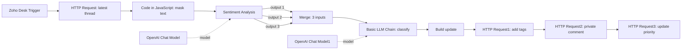

# Zoho Desk Ticket Triage

Classify new Zoho Desk tickets with sentiment analysis and an LLM, then update the ticket.

## What it does

When Zoho Desk reports a new ticket, the workflow fetches its latest thread and masks selected personal data in the text. It asks an OpenAI model to analyze sentiment and classify the ticket, then applies tags, adds a private comment, and updates priority. Negative sentiment raises the classified priority by one level.

## Flow



## Nodes

| Node | Purpose | Key settings |
|---|---|---|
| Zoho Desk Trigger | Starts on a new ticket event. | Event: `Ticket_Add`; Zoho Desk OAuth2 credential. |
| HTTP Request | Fetches the ticket's latest thread. | GET `/api/v1/tickets/{payload.id}/latestThread`; Zoho Desk OAuth2. |
| Code in JavaScript | Reads trigger and thread data, masks text, and outputs ticket ID, subject, and description. | Run Once for Each Item. Regex masks emails and names, URLs, IPv4 addresses, SSNs, card-like numbers, phone-like numbers, dates, long numbers, and street addresses. |
| Sentiment Analysis | Analyzes concatenated subject and description. | Input: `subject` plus `description`; three outputs connect to Merge. |
| OpenAI Chat Model | Supplies the model to Sentiment Analysis. | Model value: `gpt-5-mini`; connect/configure an OpenAI credential. |
| Merge | Joins the three sentiment outputs before classification. | Three inputs. |
| OpenAI Chat Model1 | Supplies the model to Basic LLM Chain. | Model value: `gpt-5-mini`; connect/configure an OpenAI credential. |
| Basic LLM Chain | Requests JSON with category, priority, and tags. | Priority labels: Low, Medium, High, Urgent; prompt uses masked subject/body. |
| Build update | Parses classification, raises priority one step for Negative sentiment, creates tags, and formats a note. | Run Once for Each Item; tone defaults to Neutral if absent. |
| HTTP Request1 | Associates tags with the ticket. | POST `/api/v1/tickets/{ticketId}/associateTag`; `orgId` header. |
| HTTP Request2 | Adds an internal comment. | POST `/api/v1/tickets/{ticketId}/comments`; `isPublic: false`. |
| HTTP Request3 | Updates the ticket priority. | PATCH `/api/v1/tickets/{ticketId}`. |

## URLs, credentials, and expressions

| Node(s) | URL or expression details |
|---|---|
| Zoho Desk Trigger | `Ticket_Add` event; Zoho Desk OAuth2 credential. |
| HTTP Request | URL expression uses `{{$json.payload.id}}` and `/latestThread`; Zoho Desk OAuth2 credential. |
| Code in JavaScript | Reads the trigger with `$('Zoho Desk Trigger').item.json`; accepts `payload`, `body.payload`, or the trigger object. Description fallback order: latest thread `content`, latest thread `summary`, ticket description, contact description. |
| Sentiment Analysis | Input expression combines `{{$json.subject}}` and `{{$json.description}}`; uses OpenAI Chat Model. |
| Basic LLM Chain | Prompt reads subject and description from the first item of Code in JavaScript; uses OpenAI Chat Model1. |
| HTTP Request1 | URL uses `$json.ticketId`; JSON body serializes `$json.tags`; `orgId` header. |
| HTTP Request2 | URL reads ticket ID and note from Build update; body sets `isPublic` to `false`; `orgId` header. |
| HTTP Request3 | URL reads ticket ID and priority from Build update; PATCH body updates priority; `orgId` header. |

The four HTTP Request URLs use the Zoho Desk API host `desk.zoho.com` in the export. The Zoho credential is `zohoDeskOAuth2Api`; the model nodes use `openAiApi` placeholders. No usable credential secrets are included.

## Prerequisites

- An n8n Cloud or self-hosted instance with a version that supports the node versions in the export. The workflow does not declare a minimum n8n version. It uses the community Zoho Desk node `@mohanvadivel/n8n-nodes-zoho-desk` and n8n LangChain nodes. Install compatible nodes before importing if your n8n instance does not have them.
- A Zoho Desk account and its organization ID.
- A Zoho Desk OAuth2 credential with access to the event trigger and ticket read/update operations. See [credential setup](docs/credentials.md); trigger-specific scopes may depend on the community node version.
- An OpenAI API key and a configured OpenAI credential in n8n.

## Setup

1. Import `workflow/zoho-ticket-triage.json` into n8n.
2. Create the Zoho Desk OAuth2 and OpenAI credentials. Assign the Zoho credential to the trigger and all four HTTP Request nodes. Assign the OpenAI credential/model to both OpenAI Chat Model nodes.
3. Replace `YOUR_ORG_ID` in the `orgId` header of every HTTP Request node.
4. Set the Zoho Desk region domain in all four HTTP Request URL expressions. The exported URLs use `desk.zoho.com`; use the matching regional API host for your account, such as `desk.zoho.eu`, `desk.zoho.in`, or `desk.zoho.com.au`.
5. Attach/configure the OpenAI model for both AI nodes. The exported model value is `gpt-5-mini`.
6. Test with a sample ticket and verify the masked input, classification, tags, private comment, and priority update.
7. Activate/publish the workflow after reviewing its behavior and permissions.

## Configuration

| What to edit | Where | Notes |
|---|---|---|
| Zoho organization ID | `orgId` header in HTTP Request, HTTP Request1, HTTP Request2, HTTP Request3 | Replace `YOUR_ORG_ID`. |
| Zoho region | URL expression in HTTP Request, HTTP Request1, HTTP Request2, HTTP Request3 | Replace the `desk.zoho.com` host with your account's API host. |
| Zoho OAuth2 credential | Zoho Desk Trigger and the four HTTP Request nodes | Select the same working credential. |
| OpenAI credential and model | OpenAI Chat Model and OpenAI Chat Model1 | The export names `gpt-5-mini`; availability depends on your OpenAI account. |
| Classification prompt and labels | Basic LLM Chain | Prompt asks for category, priority, and tags with four priority labels. |
| Masking rules | Code in JavaScript | Adjust regex and name extraction only after testing against representative data. |

## Example

Fake input ticket:

```text
Subject: Login issue for Alex Example
Body: I cannot sign in. Email alex@example.test, phone +1 555 010 0200. Please call me.
```

The mask node aims to pass text similar to:

```text
Subject: Login issue for [NAME]
Body: I cannot sign in. Email [EMAIL], phone [PHONE]. Please call me.
```

Example classification output (the exact model response can vary):

```json
{
  "tone": "Negative",
  "category": "account-access",
  "priority": "High",
  "tags": ["account-access", "login", "tone-negative"],
  "note": "Customer tone: Negative\nCategory: account-access\nPriority: High"
}
```

The workflow sends tags, a private comment, and priority to Zoho Desk. It does not return this example object as a single workflow output node.

## Privacy

- The Code node attempts to mask names found in name-like trigger fields, emails, phone-like strings, URLs, IPv4 addresses, SSNs in `123-45-6789` form, 13–16 digit card-like numbers, dates in common numeric formats, long numbers, and street addresses with a listed street suffix.
- The sentiment and classification nodes receive the masked subject and description. Other workflow metadata is not included in their prompt expressions.
- Regex masking can miss sensitive values or mask ordinary text by mistake. The name list is derived from the trigger payload and its exact fields vary.
- Review masking results and workflow behavior before production use. Do not assume this is a complete data-loss-prevention system.

## Troubleshooting

| Symptom | Likely cause / action |
|---|---|
| 404 on thread call | Check the regional API host and ticket ID. |
| `[undefined]` in URL | The expression did not resolve or the expected input data is missing. Inspect the trigger payload. |
| “Referenced node doesn't exist” | A referenced node name differs. Node names are case-sensitive; keep names unchanged. |
| “`$json` only available in Run Once for Each Item” | Set the relevant Code node to Run Once for Each Item. |
| Cannot read properties of undefined | Sentiment Analysis has three output connections. Read sentiment data from Merge. |
| 401 or 403 | Check credential selection, account region, organization ID, and OAuth scopes. |

## Known limitations

- Masking uses regular expressions and simple name extraction. It is not comprehensive and can create false positives.
- The classifier's JSON is parsed directly. Invalid or differently formatted model output can stop the workflow.
- Negative sentiment raises priority by one step using the classifier's priority. The workflow does not validate unknown priority labels before indexing the priority list.
- The workflow always posts an internal comment and applies returned tags; it has no approval step or deduplication logic.
- It updates tags, comment, and priority in sequence. A failure partway through can leave partial updates.
- The source JSON does not specify a required n8n version, trigger scope list, or tested region configuration.

## Customization ideas

- Change the category list and classification prompt to match your support taxonomy.
- Adjust priority rules or define explicit sentiment-to-priority mappings.
- Add assignment logic after classification if your team has reliable routing rules.

## License and contributing

This project is licensed under the MIT License; see [LICENSE](LICENSE). Contributions are welcome. Please include a clear description of changes and verify that exported workflow files contain no credentials or customer data.
